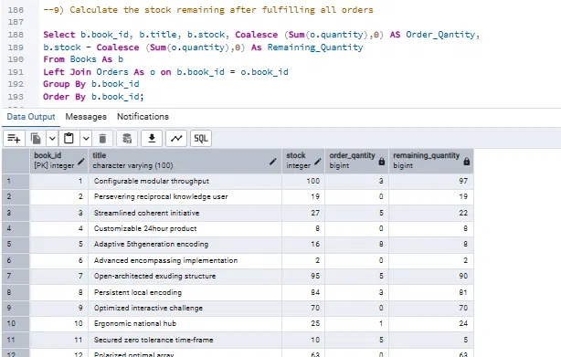
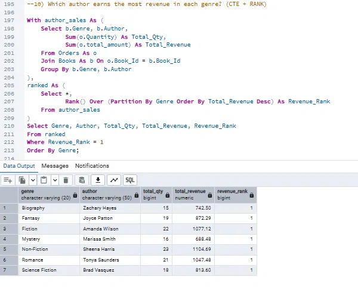
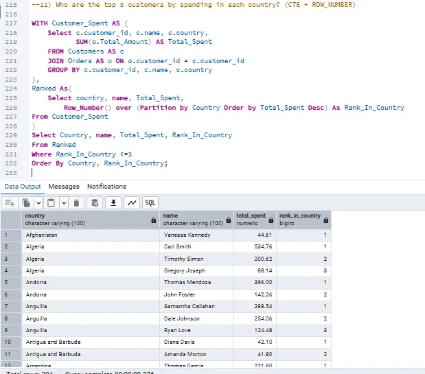

**Online Bookstore Sales Analysis (PostgreSQL)**

**Project Overview**: 

This project analyzes a bookstore database using SQL to answer business questions about sales, customer spending, authors, and inventory. It covers 22 queries, from basic filtering to advanced analysis with JOINs, CTEs, and window functions.

**Tools Used**
 1. PostgreSQL
 2. SQL
 3. pgAdmin

**Database Structure**: 

The database has 3 tables:

  Table:	 Columns

- Books: Book_Id (PK), Title, Author, Genre, Published_Year, Price, Stock

- Customers: Customer_Id (PK), Name, Email, Phone, City, Country

- Orders:	Order_Id (PK), Customer_Id, Book_Id, Order_Date, Quantity, Total_Amount

**SQL Concepts Used**

- Basic: SELECT, WHERE, BETWEEN, ORDER BY, LIMIT, DISTINCT, SUM

- Intermediate: INNER JOIN, LEFT JOIN, GROUP BY, HAVING, COUNT, AVG, COALESCE

- Advanced: CTEs (WITH), RANK(), ROW_NUMBER(), PARTITION BY

**Business Questions Answered**

**Basic Queries (11)**
 1. Retrieve all books in the Fiction genre
 2. Find books published after 1950
 3. List all customers from Canada
 4. Show orders placed in November 2023
 5. Retrieve the total stock of books available
 6. Find the details of the most expensive book
 7. Show all customers who ordered more than 1 quantity of a book
 8. Retrieve all orders where the total amount exceeds $20
 9. List all genres available in the Books table
 10. Find the book with the lowest stock
 11. Calculate the total revenue generated from all orders

**Advanced Queries (11)**
 1. Total number of books sold for each genre
 2. Average price of books in the Fantasy genre
 3. Customers who have placed at least 2 orders
 4. The most frequently ordered book
 5. Top 3 most expensive Fantasy books
 6. Total quantity of books sold by each author
 7. Cities where customers who spent over $30 are located
 8. The customer who spent the most
 9. Stock remaining after fulfilling all orders
 10. Top-earning author in each genre (CTE + RANK)
 11. Top 3 customers by spending in each country (CTE + ROW_NUMBER)

**Key Findings**
 - Total revenue: **$75,628.66** from **500 orders** (2,697 books sold, average order value of **$151.26**)
 - Top-selling genre by books sold: **Mystery** (504 books), followed by Science Fiction (447) and Fantasy (446)
 - Highest-revenue genre: **Romance** ($13,086.98), even though Mystery sold more books
 - Non-Fiction has the highest author revenue (Sheena Harris, 1,104.69), while Mystery has the lowest top-author revenue (688.48)
 - Highest-spending customer: **Kim Turner** ($1,398.90)
 - 139 of 307 customers who ordered (45%) placed 2 or more orders
 - Peak revenue month: **May 2023** ($5,110.81)
 - Most frequently ordered books: 7 books tie at 4 orders each, including *Advanced responsive extranet* and *Pre-emptive intangible         adapter*
 - Books with the lowest stock: 5 books are at **0 copies**, including *Networked systemic implementation*
 - Inventory risk: 30 books have more units ordered than stock, and *Pre-emptive intangible adapter* is short by 18 units

**Screenshots**
 1. Remaining Stock After Fulfilling All Orders (LEFT JOIN + COALESCE)

    Shows current inventory after sales. Books with no orders still appear with their full stock.

    

 3. Top-Earning Author in Each Genre (CTE + RANK)

    Finds the highest-revenue author per genre.

    

 3.Top 3 Customers by Spending in Each Country (CTE + ROW_NUMBER)
 
   Ranks customers within each country to identify the highest-value buyers per market.
   
   

**Repository Files**
 - Book_Store_Analysis.sql - table creation, data import, and all queries
 - Books.csv, Customers.csv, Orders.csv - source data
 - Q9_stock_remaining.png , Q10_top_author_per_genre.png, Q11_top_customers_per_country.png- result screenshots

**How to Run**
 - Create a new database in PostgreSQL.
 - Run the table creation section of Book_Store_Analysis.sql.
 - Update the file paths in the COPY commands to the location of the CSV files on your computer.
 - Run the import commands, then run the queries one by one.

**Author**
Animesh Mishra Email: mishra.animesh2005@gmail.com LinkedIn: [Animesh Mishra](https://www.linkedin.com/in/animesh-mishra-da/)
